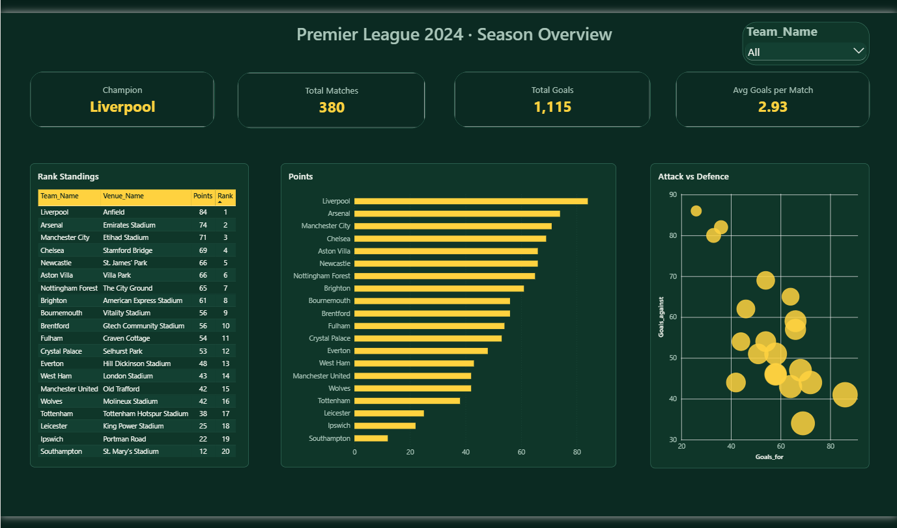

# EPL Standings ETL

A data pipeline that pulls English Premier League standings from the API-Football REST API and loads them into a small SQL Server warehouse, with a Power BI season dashboard on top. Built as a guided training project (Rows & Columns data analytics programme).

## What it does

- Extracts standings and team data for 20 clubs (2024-25 season) from 2 API endpoints using Python (requests, pandas) in a Jupyter notebook.
- Loads each batch into a staging table, then merges it into the warehouse with stored procedures - rerunning the load updates changed rows instead of adding duplicates (idempotent upserts).
- Warehouse design: a team dimension and a standings table whose primary key is the (season, team_id) pair, so each team can appear only once per season.
- Built-in checks: after loading, the pipeline queries SQL Server for row counts and duplicate keys so a bad load is caught immediately. The validation script also proves the upsert by damaging rows on purpose and reloading them.
- Power BI connects to both tables for standings reporting.

## Dashboard

The report shows the champion, total matches, total goals, full standings, points, and attack-vs-defence. The values on it (380 matches, 1,115 goals, Liverpool champions with 84 points) are from the author's own 2024-25 load, shown here as displayed on his finished dashboard.

## Tools

Python (requests, pandas, SQLAlchemy), SQL Server (T-SQL stored procedures), Power BI, Jupyter.

## Structure

- `PL_Standings_ETL.ipynb` - the author's final notebook: extract, transform and load, step by step, with its real run outputs
- `sql/01_create_tables.sql`, `02_usp_upsert_pl_standings.sql`, `03_usp_upsert_dim_team.sql` - table definitions and upsert stored procedures (reconstructed from project notes)
- `sql/04_checks_and_upsert_demo.sql` - the author's validation script: object inventory, league-table join, deliberate-damage upsert test, procedure listing
- `powerbi/` - the report file (.pbix), the Floodlit Pitch theme, and a dashboard screenshot
- `.env.example` - expected environment variables (API key, database connection)

## Status

The notebook, validation script, theme and Power BI report are the author's final working files; the notebook keeps its real run outputs. The SQL setup scripts (01-03) are reconstructed from project notes and are syntax-checked, not run-tested. One privacy scrub: the author's machine name in the config cell was replaced with an environment variable (`MSSQL_SERVER`) defaulting to the local instance.

Note: training project on public API data, not client work.
