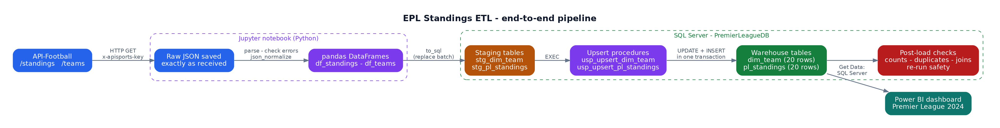
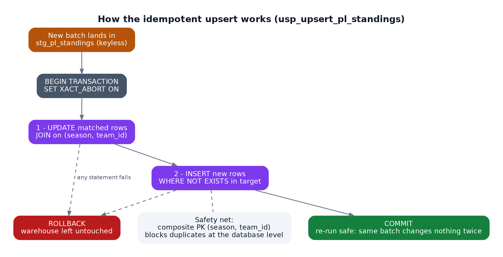
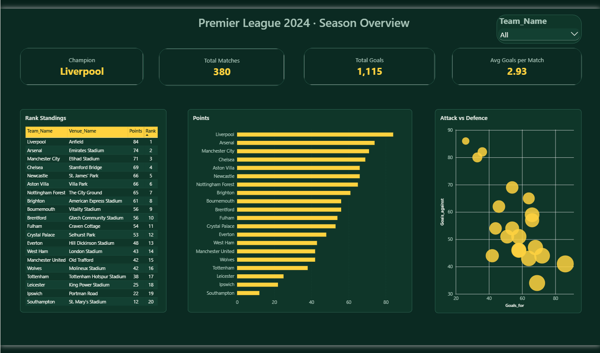

# Step-by-step walkthrough - EPL Standings ETL

This document explains the pipeline stage by stage: what each part of the code does, why it is built that way, and what you should see when it runs. Code excerpts are the project's actual code (from `PL_Standings_ETL.ipynb` and `sql/`), with annotations added for explanation.

## The pipeline at a glance



*Explanatory diagram of the as-built pipeline. The screenshots and notebook outputs quoted below are from the author's real run.*

Five things happen, in order:

1. **Extract** - ask the API-Football REST API for standings and team data, keep the raw reply.
2. **Transform** - parse the JSON, check the API's own error field, flatten into DataFrames.
3. **Build** - create the database, tables and stored procedures in SQL Server.
4. **Load** - push each DataFrame into a staging table, then upsert into the warehouse.
5. **Check** - ask SQL Server to prove the load worked before Power BI reads it.

## Step 0 - configuration, and why secrets live in `.env`

```python
load_dotenv()   # reads API_KEY and BASE_URL from .env

API_KEY  = os.getenv("API_KEY")
BASE_URL = os.getenv("BASE_URL")
LEAGUE   = 39      # Premier League
SEASON   = 2024

server   = os.getenv("MSSQL_SERVER", r".\SQLEXPRESS")
user     = ""      # blank = Windows Authentication
password = ""      # blank = Windows Authentication
```

- **What:** all settings come from environment variables; nothing secret is typed into code.
- **Why:** an API key committed to a public repository is effectively published forever, so the key lives in a local `.env` file (which `.gitignore` excludes) and only `.env.example` shows the expected names. Blank user/password means Windows Authentication handles the database login, so no database password exists in the project at all.
- **Why `LEAGUE` and `SEASON` are variables:** changing one number loads a different league or season without touching any other code.

Real output from the author's run (the key itself is never printed):

```
API_KEY loaded: True
BASE_URL: https://v3.football.api-sports.io
League / Season: 39 / 2024
SQL Server: .\SQLEXPRESS | Database: PremierLeagueDB
```

## Step 1 - extract, and why the raw reply is kept

```python
def extract(endpoint):
    """Send a GET request to one endpoint and return the raw reply text."""
    response = requests.get(f"{BASE_URL}/{endpoint}", headers=headers, params=params)
    print(f"/{endpoint}  HTTP status:", response.status_code,
          "| characters:", len(response.text))
    return response.text

standings_raw_json = extract("standings")         # raw reply, untouched
teams_raw_json     = extract("teams")             # raw reply, untouched
```

- **What:** one GET request per endpoint; the response body is stored as plain text before any parsing.
- **Why keep the raw reply:** it is the evidence of exactly what the API said. If a parsing bug appears later, you can re-check the original instead of re-calling the API (every call costs quota).
- **Why print status and length:** a tiny reply to a "successful" request is the first sign something went wrong upstream.

Real output:

```
/standings  HTTP status: 200 | characters: 10328
/teams  HTTP status: 200 | characters: 7540
```

## Step 2 - transform, and why HTTP 200 is not enough

```python
standings_data = json.loads(standings_raw_json)
teams_data     = json.loads(teams_raw_json)

# HTTP 200 can still carry errors, so check both replies
for name, d in [("standings", standings_data), ("teams", teams_data)]:
    if d["errors"]:
        raise Exception(f"{name} returned errors: {d['errors']}")
```

- **What:** the JSON text is parsed, and the API's own `errors` field is checked before anything is read from it.
- **Why:** HTTP 200 only means the server answered. This API returns 200 with an `errors` payload when the key is wrong or the quota is exhausted. Trusting the status code alone would load an empty or partial table and call it a success. The `raise` stops the pipeline loudly at the point of failure instead of letting bad data flow downstream.

The standings are nested four levels deep (`response -> league -> standings -> first table`), so the next step flattens them:

```python
df_standings = pd.json_normalize(standings_list)[[
    "rank", "team.id", "team.name", "points", "goalsDiff", "form",
    "all.played", "all.win", "all.draw", "all.lose",
    "all.goals.for", "all.goals.against"
]].copy()
```

- **Why `json_normalize`:** it turns nested keys like `all.goals.for` into flat columns in one call, which is exactly the shape a SQL table needs.
- **Why an explicit column list:** the API sends far more than the warehouse stores (logos, update timestamps, home/away splits). Selecting only what the schema expects keeps the load predictable when the API adds fields.

Real output:

```
Standings rows: 20
Teams rows: 20
```

## Step 3 - build the warehouse in SQL

One notebook cell drops and recreates `PremierLeagueDB`, then the table and procedure definitions run.

> **Warning:** the drop removes anything already in `PremierLeagueDB`. Point this at a disposable training database only, or use the manual Path B described in the README.

- **Why drop and recreate in a training project:** it makes every run start from a known empty state, so results are reproducible. In a real production pipeline you would never do this; you would migrate the schema in place.
- **Why `CREATE TABLE` has keys but staging does not:** the warehouse tables (`dim_team`, `pl_standings`) carry the data-quality rules - a composite primary key on `(season, team_id)` and a foreign key to `dim_team`. The staging tables are keyless landing areas for the current batch only, so a bad batch can be inspected or discarded without touching the warehouse.
- **Why teams load before standings:** `pl_standings` has a foreign key to `dim_team`. A standings row pointing at a team that does not exist yet would be rejected, so the dimension loads first.

## Step 4 - load, and how the upsert makes reruns safe



*Explanatory diagram of the procedure logic in `sql/02_usp_upsert_pl_standings.sql`.*

```python
with engine.begin() as conn:   # one transaction: commits only if every step works

    # 1) Teams: clear staging -> copy DataFrame in -> procedure upserts into dim_team
    conn.execute(text("TRUNCATE TABLE dbo.stg_dim_team"))
    df_teams.to_sql("stg_dim_team", conn, schema="dbo",
                    if_exists="append", index=False)
    conn.execute(text("EXEC dbo.usp_upsert_dim_team"))

    # 2) Standings: same pattern, after teams (foreign key dependency)
    conn.execute(text("TRUNCATE TABLE dbo.stg_pl_standings"))
    df_standings.to_sql("stg_pl_standings", conn, schema="dbo",
                        if_exists="append", index=False)
    conn.execute(text("EXEC dbo.usp_upsert_pl_standings"))
```

- **Why one `engine.begin()` block:** it wraps every step in a single transaction. If any step fails, nothing commits, so the warehouse never holds a half-loaded batch.
- **Why TRUNCATE staging first:** staging holds exactly one batch. Clearing it guarantees no leftover rows from a previous run leak into this one.

Inside the procedure, the upsert itself is two statements:

```sql
-- 1) UPDATE rows that already exist (same season + team_id)
UPDATE t
SET t.rank = s.rank, t.points = s.points, /* ... */
FROM dbo.pl_standings AS t
JOIN dbo.stg_pl_standings AS s
  ON t.season = s.season AND t.team_id = s.team_id;

-- 2) INSERT rows that are new
INSERT INTO dbo.pl_standings (/* ... */)
SELECT /* ... */
FROM dbo.stg_pl_standings AS s
WHERE NOT EXISTS (
    SELECT 1 FROM dbo.pl_standings AS t
    WHERE t.season = s.season AND t.team_id = s.team_id
);
```

- **What:** UPDATE refreshes rows the warehouse already has; INSERT adds only rows it does not.
- **Why this instead of delete-and-reload:** after a match week, most rows change and none are new. An upsert applies the new numbers in place, keeps load time proportional to the batch, and means rerunning the notebook (for example after a failure) refreshes the data instead of duplicating it. This property - rerunning is safe - is called idempotency, and it is the central design goal of the pipeline.
- **Why `SET XACT_ABORT ON` and an explicit transaction in the procedure:** if either statement fails midway, the whole batch rolls back rather than leaving the table half-updated.

## Step 5 - check, because "Load finished" is not proof

```python
check_dupes_sql = """
SELECT COUNT(*) AS duplicate_keys
FROM (
    SELECT season, team_id
    FROM dbo.pl_standings
    GROUP BY season, team_id
    HAVING COUNT(*) > 1
) AS d
"""
```

- **What:** after loading, the notebook queries SQL Server for row counts, a duplicate scan on the composite key, and a join check between the two tables.
- **Why:** the print statement "Load finished" only means no error was raised. These checks ask the database itself whether the result is right: 20 teams, 20 standings rows, 0 duplicate keys. The validation script (`sql/04_checks_and_upsert_demo.sql`, Part C) goes further and deliberately damages rows - sets one team's points to 0, deletes a team - then reloads to prove both the UPDATE and INSERT paths repair the damage. Run Part C only on a disposable copy; it modifies and deletes data on purpose before repairing it.

Real output:

```
     table_name  row_count
0      dim_team         20
1  pl_standings         20
   duplicate_keys
0               0
```

And the re-run check (same load executed a second time) returns identical counts - the idempotency proof.

## Step 6 - visualize in Power BI

Power BI connects to SQL Server and imports only `dim_team` and `pl_standings`, linked on `team_id`.

- **Why only the two warehouse tables:** staging tables are landing areas, not data; importing them would add empty duplicates to the model.
- **Why the one-to-many relationship matters:** it lets the dashboard place stadium details (from `dim_team`) next to league numbers (from `pl_standings`) in one visual, as in the finished report below.



*Screenshot of the author's finished dashboard from his own 2024-25 load (380 matches, 1,115 goals, Liverpool champions with 84 points).*

## Troubleshooting

| Symptom | Likely cause | Fix |
| --- | --- | --- |
| `API_KEY loaded: False` | `.env` missing or misnamed | Copy `.env.example` to `.env` and fill in the key |
| Extract raises "returned errors" | Invalid key or quota exhausted | Check the key and usage at api-football.com |
| `InterfaceError` / driver not found | ODBC Driver 17 not installed | Install "ODBC Driver 17 for SQL Server" |
| Login failed for the instance | Wrong `MSSQL_SERVER` value | Set `MSSQL_SERVER` in `.env` to your instance name |
| Foreign-key error on standings load | Teams were not loaded first | Run the load cell as written; it loads teams before standings |

## Test status

The notebook and validation script are the author's final working files, with their real run outputs kept. The standalone setup scripts (`sql/01` to `03`) are reconstructed from project notes, syntax-checked but not run-tested; the notebook carries the same SQL inline with real outputs.
